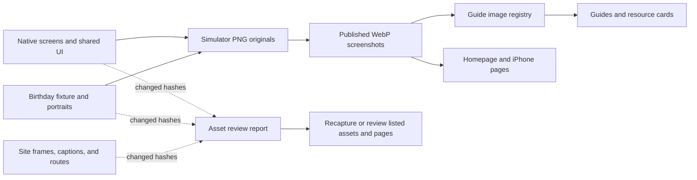

# Marketing UI asset maintenance

`ui-asset-map.json` maps each published native screenshot to its original PNG, native screen code, shared rendering dependencies, fixture inputs, landing components, and routes. Repository locations are relative to this landing repository: `.` is `gatherory-landing`, `../ios-apps/gatherory` is the native app, and `../gatherory-web-app` is the web app. The checker hashes files with Node's built-in filesystem and SHA-256 modules; it does not install or call a database, simulator, image converter, or network service.



`pnpm assets:check` performs the read-only check. `pnpm assets:report` refreshes
the report, and `pnpm build` runs that report before building the static site.
The map is checked when a command runs; it is not a background file watcher.
Use `pnpm test:assets` to verify the change detector and guide-to-asset coverage.

Run the read-only check from the landing repository root:

```sh
node scripts/check-marketing-assets.mjs
```

The default command and `--check` print each asset's state without writing files. `--strict` returns a failing exit code for changed paths, unreviewed assets, or unavailable dependencies, so CI can opt into blocking. A normal check reports the same issues as warnings and exits successfully. Use `--report` to write the generated findings to [asset-status.md](./asset-status.md):

```sh
node scripts/check-marketing-assets.mjs --report
```

The checker reports `RECAPTURE REQUIRED` when native screen code, shared native UI, screenshot fixture data, bundled fixture images, or an original simulator PNG changes. Review the affected native state and recapture or verify the capture and its WebP encoding before acknowledging it. It reports `LANDING REVIEW REQUIRED` when a published WebP, landing component, route, localization string, guide content, or guide registry changes. Inspect the listed route at the relevant desktop and narrow viewport, including the full image ratio and captions, before acknowledging it. `UNKNOWN` means a required repository or dependency path could not be read; the checker does not treat an unavailable path as fresh.

After recapturing or visually reviewing one specific asset against its listed routes and dependencies, acknowledge only that ID. A review may use current capture evidence or rendered route evidence; the baseline records the result and does not require a particular reviewer role:

```sh
node scripts/check-marketing-assets.mjs --ack duo-ideas
```

Supported IDs are `home`, `ideas`, `decide`, `events`, `manage`, `duo-ideas`, `duo-decide`, and `duo-manage`. Acknowledgement records current dependency hashes and a timestamp for that asset in [asset-baseline.json](./asset-baseline.json). It does not generate a screenshot, update another asset's baseline, or refresh `asset-status.md`; run `--report` separately if the checked-in report should be refreshed. If a shared native or landing dependency affects several screenshots, inspect and acknowledge each one separately.

The initial baseline records the files found when this map was assembled. Every initial entry remains `reviewed: false` because the hash snapshot cannot establish whether the current native screens still match the captures. The first strict check therefore remains red until each screenshot has been reviewed and explicitly acknowledged. The command is an audit record after review, not a way to silence a report.

The native captures use `Gatherory/App/BirthdayMarketingFixtures.swift` and bundled `MarketingBirthday*`, `MarketingGuest*`, and `MarketingRequest*` asset-catalog entries in the iOS repository. The app launches against an in-memory store with the documented fixture flags. The web repository's wedding `development-event-images.ts` seed is a different fixture and is not used during capture; its database update script is not part of this maintenance path. Some stock portrait source URLs are shared with `development-profile-images.ts`, but the native fixture bundles copies and captures them offline. Photo credits and external photo source notes remain in the separate image variety and lifestyle source records; the UI asset map does not replace those records or track unrelated SEO stock photography.

Guide routes use image references from guide frontmatter and the central guide asset registry. The `/resources` hub also renders each guide's hero image as a card thumbnail. When adding or changing a guide hero or inline UI screenshot, update `guideContent` and the `/resources` `currentUses` entry in `ui-asset-map.json`; the marketing asset test checks the map against the current Markdown and resource-card renderer. The map records the specific guide files and routes that use each screenshot, so a guide edit flags only screenshots rendered by that guide; shared guide renderer and screenshot-registry changes flag every screenshot used in a guide. Stock photo registry changes and photo attribution remain separate from this UI screenshot map.
